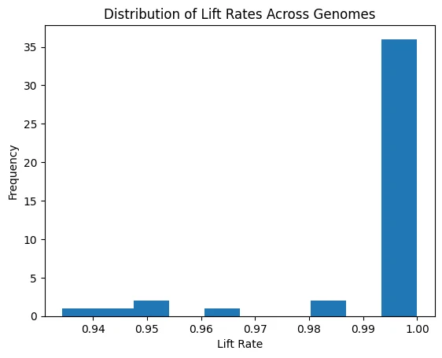
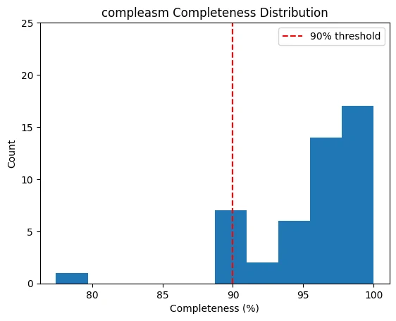
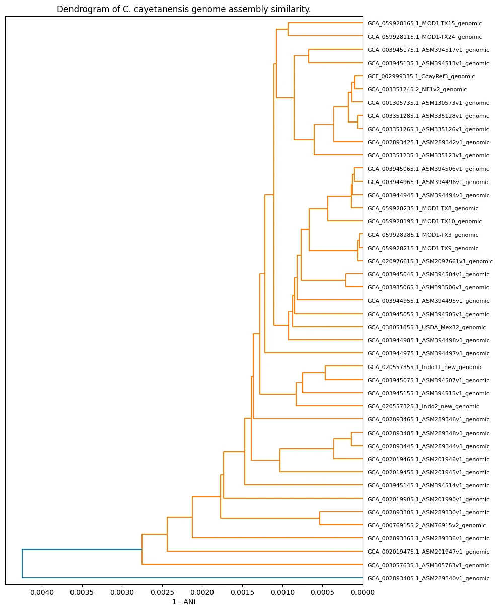
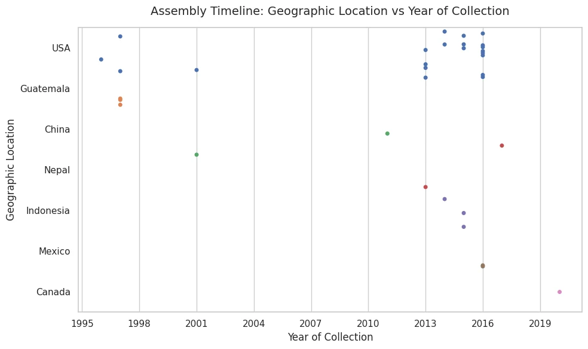
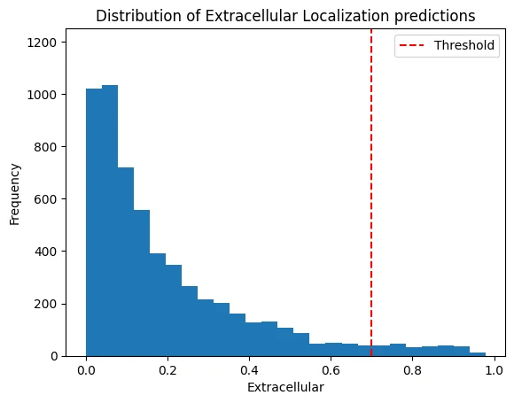
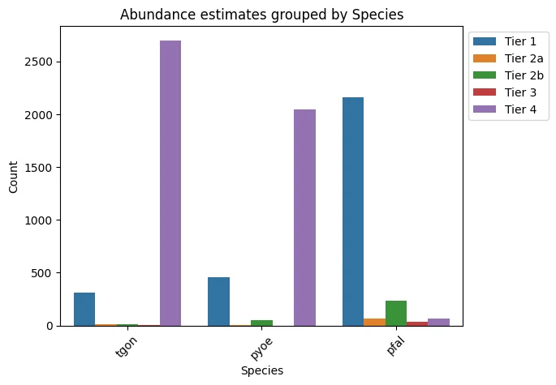
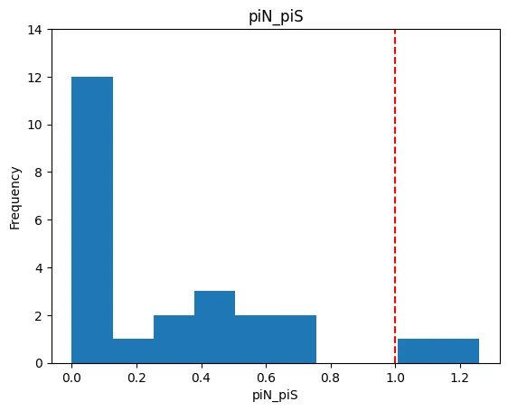

*This write-up is in progress: target discovery is written up below, binder design is still underway.*

## Rationale

In the summer of 2026, the United States saw an unprecedented [outbreak of cyclosporiasis](https://www.cdc.gov/cyclosporiasis/outbreaks/07-26/index.html), linked to *Cyclospora cayetanensis* found on iceberg lettuce, resulting in nearly 13,000 cases across 21 states.

While the outbreak is thankfully over, one scientific headline that caught my eye was on the difficulty of detecting Cyclospora oocysts. Samples usually come from stool, food, or environmental sources, and detection involves a targeted sequencing workflow that looks for a set of [particular genetic markers](https://pmc.ncbi.nlm.nih.gov/articles/PMC12153321/). Despite this established procedure, there are a few specific challenges with detection:

1. They’re found in very small quantities in foodborne cases, especially when that food is produced and packaged in massive volumes, like iceberg lettuce.
1. It’s difficult to amplify Cyclospora signals because they only grow in the human gut, not in culture.
1. Oocysts have tough outer shells, which makes accessing DNA tricky.

This made me wonder—why isn’t there a rapid antigen test (like the ones we’re familiar with from COVID testing) for *C. cayetanensis*? I found a 2023 paper in which researchers used [aptamers](https://pmc.ncbi.nlm.nih.gov/articles/PMC11807056/) to do just that, detecting oocyst wall proteins.

However, those aptamers were made from nucleotides and aren’t feasible in point-of-care settings. Ideally, a Ccay antigen test would be easy to produce, highly sensitive, with a long shelf life, and usable in food production supply chain settings.

I thought it might be possible to create a protein binder for a lateral flow assay that meets those criteria, so I set about designing de novo peptide binders for Ccay for use in a rapid antigen test

## Workflow

My overall workflow has two parts: antigen/target discovery and binder design.

### Antigen/target discovery

A rapid antigen test needs a target that is both invariant across strains and physically accessible to a capture protein. I’m defining the ideal target as the intersection of three independent filters:

- Conserved across strains, as determined by nucleotide diversity
- Surface-accessible, as determined by subcellular localization prediction\*
- Abundant enough to detect in a sample preparation, as determined by orthogroup comparison

Typically, RATs might target surface-accessible antigens; however, since Ccay’s tend to be [highly variable](https://link.springer.com/article/10.1186/s12864-016-2632-3), I’m referring to our target proteins simply as candidates or targets.

>\* *Initially, I selected for for surface accessibility because it eliminates the need for any lysing agent to break down oocyst walls. However, further research into the Ccay life cycle made it clear that most non-oocyst-wall proteins still tagged for extracellular export are typically involved in oocyst wall formation and are localized to its inner layer—i.e., not accessible at the oocyst wall surface. However, I’m operating under the assumption that these proteins would at least be relatively more accessible after lysing an oocyst with something like glass beads.*

### Binder design

Given a set of candidates, I’ll use RFDiffusion3 to design de novo binders such that they meet the following criteria:

| **Criterion** | **Details** |
|---|---|
| **Sub-nanomolar affinity (KD, ddG)** | Requires a fast association rate (high k_on, low k_off) predicted via QSKR models. Essential for low oocyst concentrations and rapid test formats. |
| **High epitope selectivity** | Prevents cross-reactivity with other contaminants/parasites in foodborne samples to reduce false positives. |
| **Orthogonal sandwich pairing** | Must be compatible with sandwich assay formats. |
| **Room temperature stability & extended shelf life** | Eliminates cold storage needs. Achieved via reduced oxidation-prone residues, salt bridges instead of disulphide bonds, rigid folding, and low surface hydrophobicity. |
| **Reversible two-state unfolding** | Ensures binders readily adopt active structures upon exposure to the analyte solution. |
| **High microbial expression** | Facilitates efficient mass production in bacterial systems using codon optimality, stable GC content, avoiding mRNA hairpins/disulphide bonds, and N-end stability. |
| **Surface immobilization capacity** | Must bind to nitrocellulose while orienting target-binding regions outward. |

## Step 1: Quality control and annotation transfer across *Cyclospora cayetanensis* strain assemblies.

The goal here was to establish a high-quality, non-redundant working set of CCay genome assemblies and transfer reference annotations onto each one. Unfortunately, only one CCay assembly carries a full annotation, assembly quality varies widely across submissions, and the public set contains duplicate BioSamples and suppressed records. Apparent "variability" in a gene could just as easily be missing coverage, a contig break, or a truncated gene model.

To remedy this, I filtered assemblies on completeness with compleasm, resolved duplicates and suppressed entries, characterized population structure with sourmash signatures (alongside geography and collection date), and lifted the CcayRef3 annotation onto every surviving assembly with Liftoff.

**Results:**

- 43 out of the 47 deposited genomes have more than 90% completeness.
- All of them are very similar to each other
- There is some clustering by year, probably by outbreak

*Lift rates across genomes.*

*compleasm completeness, with the 90% threshold marked.*

*Assembly similarity (1 - ANI).*

*Where and when the assemblies were collected.*

## Step 2. Predicting subcellular localizations of Cyclospora cayetanensis proteins using DeepLoc2.1.

*DeepLoc 2.1 extracellular scores, with the 0.7 threshold marked.*

I wanted to determine the localizations of the C. cayetanensis (CCay) proteome to find a strong candidate for a rapid antigen test target (with a focus on extracellular proteins). Because CCay has little to no protein localization data (MS, mRNA, etc.) to use as a reference, I used DeepLoc2.1, a deep learning model that predicts protein localization, to shortlist targets.

## Step 3. Determining relative protein abundance in Cyclospora cayetanensis using orthologs from Toxoplasma gondii.

An ideal antigen target is also highly abundant, so I needed to determine the relative steady-state protein abundances (SSAs) in C. cayetanensis (CCay)’s proteome to find a strong candidate for a rapid antigen test target. Because no experimental protein expression data (MS, mRNA, etc.) are available for CCay to use as a reference, I identified orthologous genes/proteins for all candidate proteins with OrthoFinder and used them as a proxy to estimate SSA in CCay. Thankfully, I could do this using pre-existing relative protein abundance data from its closest taxonomic relative in the PaxDB.

This is the abundance estimation protocol I used for all the orthogroup scenarios:

| **Tier** | **Scenario (Ccay:Ortho)** | **Action** |
|---|---|---|
| 1 | 1:1 ortholog | **Exact**: duplicate the abundance value, with preference for closer phylogenetic relatives. |
| 2a | 1:many orthologs | **Median**: take the median of log10 normalized ppm ortholog abundances. If the ortholog lacks abundance data, retry with next closes relative. |
| 2b | many:1 ortholog | **Divide**: divide the ortholog abundance among the target proteins. If the ortholog lacks any abundance data, try with with the next closest phylogenetic relative. |
| 3 | many:many orthologs | **Pooled divide**: Take the total expression pool and distribute it among the target group. |
| 4 | too much missing data | **Inconclusive**. Applies when no ortholog carries abundance data or when a multi-ortholog group has under 80% coverage AND there are fewer than 3 measured orthologs. |

It's worth noting there are certainly more comprehensive and robust ways to estimate protein SSA from orthologs than the ones taken here. To keep this project in scope, I'm using useful proxies where possible.

*Which tier each protein landed in, by reference species.*

Example table of Tier 1 orthologs:

| **Orthogroup** | **Species** | **ccay** | **Orthologs** | **abundance** |
|---|---|---|---|---|
| OG0000679 | pyoe | XP_026193429.1 | XP_724814.1 | 13244.0 |
| OG0001445 | pyoe | XP_026190741.1 | XP_728795.1 | 5073.0 |
| OG0000358 | pyoe | XP_022588287.1 | XP_726754.1 | 4405.0 |
| OG0000404 | pyoe | XP_026189744.1 | XP_730727.1 | 3624.0 |
| OG0000393 | pyoe | XP_022592409.1 | XP_725477.1 | 3518.0 |

## Step 4. Align candidate genes across all genomes to determine conservation.

Finally, I needed to align candidate genes across my available genomes to determine how conserved they were. I chose to do the alignments once I had a shortlist from the intersection of Steps 2 and 3; otherwise, getting conservation metrics for the full proteome across more than 40 genomes would have been very computationally expensive. Using pal2nal to do codon-aware alignment and SNPGenie to identify and categorize polymorphism, I was able to estimate nucleotide diversity among my sample genomes:

*piN/piS across the shortlist, with neutrality marked at 1.0.*

## Step 5. Create candidate shortlist.

Intersecting extracellular proteins with abundance estimates left me with a shortlist of 63 candidates. Filtering that down to log10 ppm > 1 and piN / piS < 1, we’re left with these 9 candidates (functional predictions come from InterProScan domain identification):

| **#** | **Gene Name** | **Protein/Function** |
|---|---|---|
| 1 | LOC34622212 | uncharacterized, membrane attack complex/perforin (MACPF) domain profile |
| 2 | LOC34621387 | uncharacterized, Venus Flytrap-like |
| 3 | LOC34624131 | sporozoite developmental protein |
| 4 | LOC34619802 | uncharacterized, S1/P1 nuclease |
| 5 | LOC34617317 | uncharacterized, peptidase activity |
| 6 | LOC34621487 | proteasome subunit beta type-2-A |
| 7 | LOC34617670 | 3-ketoacyl-CoA thiolase |
| 8 | LOC34619099 | uncharacterized, predicted peptidase M16 |
| 9 | LOC34624017 | uncharacterized |

Some brief exploration of these genes/proteins:

[COMING SOON]
